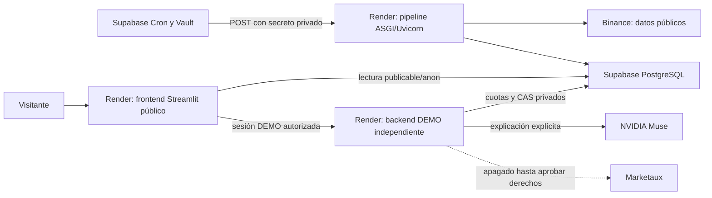

# 02 · Reconstrucción cloud en recursos propios

Esta guía documenta la arquitectura real, no crea ni modifica servicios automáticamente. El profesor debe usar **sus propias cuentas, proyecto, secretos, usuarios y registro**. No vincule los proyectos del autor ni copie sus claves. La ruta local [01](01_INSTALACION_LOCAL.md) no necesita estas cuentas.



El código HTTP actual implementa **ASGI sobre Uvicorn**, no depende de FastAPI. Pipeline y DEMO son entrypoints distintos. Ningún componente ejecuta trading real. V1 conserva ocho features y gate 0.60; sentimiento y LLM no alteran probabilidades ni decisiones.

## 1. Crear cuentas e inventario

Necesita Supabase, Render y, si publicará imágenes privadas, GitHub/GHCR propios. NVIDIA es opcional con cuenta/créditos propios; Marketaux es opcional y requiere verificar plan y derechos. Revise planes y cuotas antes de crear recursos: Render Free comparte 750 horas mensuales entre servicios y puede suspender instancias por inactividad. Tres servicios activos todo el mes superarían ese presupuesto. No se garantiza capacidad gratuita ilimitada ni se autoriza ningún plan de pago por esta guía.

Clone/forkee el repositorio público, anote el SHA y desactive auto-deploy en su distribución hasta validar los cambios. Cree nombres propios, por ejemplo `mi-alpha-pipeline`, `mi-alpha-demo` y `mi-alpha-front`. Las URLs reales se obtienen **después** de que Render cree cada servicio; no copie las del autor como dependencias de su reconstrucción.

## 2. Crear Supabase

En Supabase cree un proyecto nuevo, seleccione región y una contraseña de base nueva. Guárdela en un gestor privado. Anote Project URL y las claves de API:

- Backend: clave **secret/service_role**, sólo servidor. Es privilegiada y puede omitir RLS; no equivale a una clave limitada a las RPC DEMO. La API debe restringir sus rutas y validar cada acción.
- Frontend: **publishable/anon**; RLS y GRANT deben permitir solamente lecturas aprobadas.

La contraseña PostgreSQL no es la API key ni la contraseña DEMO. El runtime Supabase utiliza REST/RPC por HTTPS y no necesita `DATABASE_URL` para estos servicios.

## 3. Migraciones, en orden y sólo en el proyecto NUEVO

Revise los diez SQL versionados. Puede ejecutarlos, uno por uno, en SQL Editor de su proyecto vacío; así no necesita instalar una CLI ni vincular proyectos existentes. No use el esquema `deploy/local/schema.sql` en Supabase: es otro perfil.

| Orden | Archivo `supabase/migrations/` | Propósito |
|---:|---|---|
| 1 | `20260921053406_initial_alpha_engine_persistence.sql` | Candles, predictions, recomendaciones, RLS base |
| 2 | `20260921073450_add_live_observability.sql` | Ejecuciones y evaluaciones |
| 3 | `20260922021030_add_recommendation_request_audit.sql` | Auditoría de solicitudes |
| 4 | `20260922030000_add_public_dashboard_views.sql` | Vistas históricas de auditoría |
| 5 | `20260922040000_allow_rate_limited_recommendation_audit.sql` | Estados de rate limit |
| 6 | `20260922075212_grant_server_read_public_views.sql` | Lectura server de vistas |
| 7 | `20260923024505_schedule_render_live_cycle.sql` | Extensiones, Vault y Cron |
| 8 | `20260924093000_add_prescriptive_news_context.sql` | Caché legado Alpha Vantage |
| 9 | `20260926120000_paper_trading.sql` | Tablas/RPC de cartera académica privada |
| 10 | `20260926160000_live_evaluation_pending.sql` | RPC privada de evaluación |
| 11 | `deploy/render/sql/academic_demo_state.sql` | Estado, cuota y dos RPC DEMO privados |

La migration 7 programa `alpha-engine-live-cycle` cada minuto; antes de tener Vault y backend listo puede fallar. En un montaje nuevo puede preparar primero los otros SQL y aplicar la 7 al configurar el destino del paso 6, sin cambiar el contenido del archivo. Si utiliza Supabase CLI, no marque una migration como aplicada manualmente sin conciliar el historial. No mezcle SQL Editor y `db push` a ciegas. **No aplique nuevamente estas migraciones a una producción existente**; algunas no son idempotentes. El esquema DEMO sí fue diseñado con idempotencia sobre sus objetos, pero debe inspeccionarse antes de aplicarlo.

Los archivos históricos no garantizan el estado real de una instalación previa. En particular, las vistas de auditoría se restringieron posteriormente en la instalación del autor: el lector cloud actual **no necesita** acceso público a ellas. Para un proyecto nuevo y antes de habilitar su lector, revise y ejecute allí exclusivamente:

```sql
BEGIN;
REVOKE ALL ON public.public_pipeline_runs,
  public.public_recommendation_request_summary FROM PUBLIC, anon, authenticated;
GRANT SELECT ON public.public_pipeline_runs,
  public.public_recommendation_request_summary TO service_role;
COMMIT;
```

Es un ajuste de seguridad para una instalación propia, no un comando para ejecutar sobre el sistema de presentación. No revoque permisos de otras tablas, Cron ni funciones para resolver discrepancias sin analizar dependencias.

## 4. Comprobar permisos antes de publicar

Consultas de inspección; no imprimen secretos:

```sql
SELECT c.relname, c.relrowsecurity,
       has_table_privilege('anon',c.oid,'SELECT') AS anon_select,
       has_table_privilege('anon',c.oid,'INSERT,UPDATE,DELETE') AS anon_any_dml,
       has_table_privilege('authenticated',c.oid,'INSERT,UPDATE,DELETE') AS auth_any_dml
FROM pg_class c JOIN pg_namespace n ON n.oid=c.relnamespace
WHERE n.nspname='public' AND c.relname IN
 ('candles','predictions','live_evaluations','academic_demo_state',
  'public_pipeline_runs','public_recommendation_request_summary');

SELECT tablename,policyname,roles,cmd,qual,with_check
FROM pg_policies WHERE schemaname='public';

SELECT p.proname,p.prosecdef,
       has_function_privilege('anon',p.oid,'EXECUTE') AS anon_execute,
       has_function_privilege('authenticated',p.oid,'EXECUTE') AS auth_execute,
       has_function_privilege('service_role',p.oid,'EXECUTE') AS server_execute
FROM pg_proc p JOIN pg_namespace n ON n.oid=p.pronamespace
WHERE n.nspname='public';
```

Resultado mínimo: RLS activo y SELECT público únicamente sobre las tres tablas de mercado aprobadas; sin DML público. Las dos vistas anteriores y el estado DEMO deben negar acceso público. Ambas RPC `academic_demo_state_read()` y `academic_demo_state_cas(bigint,jsonb)` son `SECURITY INVOKER`, con EXECUTE sólo para service_role; el estado concede SELECT/UPDATE al servidor, no INSERT/DELETE. Revisar también columnas expuestas, concesiones a PUBLIC, roles heredados y funciones SECURITY DEFINER. `has_*_privilege` incluye permisos efectivos heredados; no basta con buscar una fila ACL de `anon`.

No active `NORTHFLANK_PUBLIC_DATA_APPROVED=true` si las verificaciones fallan. No cree políticas amplias para hacer desaparecer un error. Consulte [RLS oficial](https://supabase.com/docs/guides/database/postgres/row-level-security).

## 5. Backend del pipeline en Render

Cree un Web Service **nuevo**, Native Python, desde su copia del repositorio:

```text
Python: 3.12.14
Build: pip install -r deploy/render/requirements.txt
Start: uvicorn deploy.render.app:app --host 0.0.0.0 --port $PORT --workers 1
Health: /health
```

Seleccione Free únicamente si existe margen de horas/transferencia y no hay cargos automáticos que no quiera asumir. Configure `APP_ENV=production`, `STORAGE_PROVIDER=supabase`, su URL/clave **server**, dos secretos nuevos y distintos `INTERNAL_CRON_SECRET` / `RECOMMENDATION_API_SECRET`, `MODEL_CONFIDENCE_THRESHOLD=0.60`, `MODEL_PATH=models/xgboost_v1.joblib`, `SYMBOL=BTCUSDT`, `INTERVAL=1m`, noticias y V3 apagados. Consulte el inventario [03](03_VARIABLES_Y_CREDENCIALES.md). No requiere NVIDIA para ejecutar el pipeline.

Compruebe `https://DOMINIO_REAL/health` → HTTP 200. Una solicitud sin bearer a `/internal/run-cycle` debe dar 401. No use el Dockerfile académico para este proceso: `Dockerfile.backend`, cuando exista en la distribución, inicia `academic_only` y excluye deliberadamente el pipeline. Puede usar el arranque Native Python anterior o preparar su propia imagen con entrypoint `deploy.render.app:app`.

## 6. Cron y Vault propios

En el Vault de su proyecto cree, mediante entrada privada del Dashboard, estos dos nombres exactos:

| Nombre Vault | Valor que debe configurar privadamente |
|---|---|
| `alpha_engine_render_cycle_url` | URL HTTPS real de su pipeline terminada en `/internal/run-cycle` |
| `alpha_engine_internal_cron_secret` | Exactamente su `INTERNAL_CRON_SECRET` del pipeline |

No coloque estos valores en SQL versionado, historial público ni capturas de `vault.decrypted_secrets`. No reutilice el secreto DEMO. Aplique la migration 7 si la reservó; confirma formato de destino Render y longitud de token. El job utiliza `pg_net` con timeout 90 s. Es un POST por minuto, no una inferencia dentro de PostgreSQL. Vea [pg_net](https://supabase.com/docs/guides/database/extensions/pg_net).

```sql
SELECT jobname,schedule,active FROM cron.job
WHERE jobname='alpha-engine-live-cycle';
SELECT status,start_time,end_time FROM cron.job_run_details
ORDER BY start_time DESC LIMIT 5;
SELECT status,started_at,new_prediction FROM public.pipeline_runs
ORDER BY started_at DESC LIMIT 5;
SELECT max(generated_at) AS latest_prediction FROM public.predictions;
```

Encolar un POST con pg_net o ver un job `succeeded` no basta: compruebe los logs del backend, HTTP del ciclo y nuevas filas. El cloud comienza vacío: primera ejecución llena contexto y crea una predicción; la evaluación necesita el cierre siguiente. No espere automáticamente las 241 predicciones del replay local. Mantenga una política de retención propia revisada: logs Cron y trazas pueden consumir la cuota de Supabase Free. No use limpiezas globales ni VACUUM FULL como receta rutinaria.

## 7. Backend DEMO independiente

Cree otro servicio Free únicamente si cabe en la cuota compartida. Mismo build/Python, pero:

```text
Start: uvicorn deploy.render.academic_only:app --host 0.0.0.0 --port $PORT --workers 1
Health: /health
```

Su `SUPABASE_KEY` es server/service_role, siempre fuera del frontend. Necesita la migration 11. Genere secretos distintos de los del pipeline, incluso los dos requeridos por readiness. Configure los nombres `ACADEMIC_DEMO_*` de [03]. Inicialmente: DEMO habilitado si ya configuró usuarios/ventana, LLM=false, NEWS=false y NEWS_RIGHTS_APPROVED=false.

Para usuarios NUEVOS de su instalación, en una terminal privada con dependencias Python:

```text
python scripts/configure_academic_users.py --users administrador profesor companero_01 companero_02
python -c "from datetime import datetime,timedelta,timezone; print((datetime.now(timezone.utc)+timedelta(hours=24)).isoformat())"
python -c "import secrets; print(secrets.token_hex(32))"
```

El primer comando solicita contraseñas ocultas y crea `.academic-demo-users.json` con hashes PBKDF2 salados; no lo publique. Configure su JSON en `ACADEMIC_DEMO_USERS_JSON` mediante el panel privado de Render. El segundo produce una expiración para **su** DEMO, dentro de la ventana máxima de 48 horas. El tercero genera un secreto propio de sesión; no grabe su salida. No extienda cuentas de otro entorno. Entregue contraseñas individualmente por canal privado.

Sesiones de 15 minutos, revocación al salir, NVIDIA 10 intentos globales/día UTC y 3 por usuario/día, una generación concurrente; Marketaux 48/día y 30 minutos entre intentos. Fallos cuentan. Las reservas viven en Supabase y sobreviven reinicios; no use almacenamiento efímero como sustitución silenciosa. Carteras persistentes no están habilitadas en esta API.

## 8. Construir y publicar frontend Docker/GHCR propios

El lector utiliza `Dockerfile.frontend.northflank` y su ignore específico, contexto raíz. No depende de Northflank para ejecutarse en Render. Construya desde su clon, sin archivos privados adicionales:

```text
docker build --platform linux/amd64 -f Dockerfile.frontend.northflank -t alpha-front:mi-version .
docker image inspect alpha-front:mi-version --format "{{.Os}}/{{.Architecture}}"
docker login ghcr.io --username SU_USUARIO
docker tag alpha-front:mi-version ghcr.io/SU_USUARIO/alpha-front:mi-version
docker push ghcr.io/SU_USUARIO/alpha-front:mi-version
docker buildx imagetools inspect ghcr.io/SU_USUARIO/alpha-front:mi-version
```

Use propietario en minúsculas para la ruta GHCR. En login introduzca de forma interactiva un token propio de permisos mínimos `write:packages`; nunca lo escriba en el comando ni en Git. Verifique que el paquete sea **PRIVATE**, anote el digest del manifiesto `linux/amd64` y conserve tags anteriores. Un índice OCI puede contener otro digest para la plataforma; no confundirlos. Render necesita una credencial de registro independiente `read:packages` del propietario autorizado.

No podrá tirar del paquete privado del autor: construya y publique el suyo. Para una instalación propia puede usar otro registro compatible, sujeto a sus condiciones; no cambie a público por defecto.

## 9. Frontend Render desde Existing Image

Cree su Web Service desde la imagen propia **por digest**, Free si procede. Puerto **8501** y health `/_stcore/health`; Streamlit usa WebSocket `/_stcore/stream`. Configure:

```text
PORT=8501
STORAGE_PROVIDER=supabase
SUPABASE_URL=https://SU_PROYECTO.supabase.co
SUPABASE_KEY=REPLACE_WITH_OWN_PUBLISHABLE_KEY
FRONTEND_PUBLIC_HOST=DOMINIO_REAL_SIN_HTTPS
NORTHFLANK_PUBLIC_READ_ONLY=true
NORTHFLANK_PUBLIC_DATA_APPROVED=false
ACADEMIC_DEMO_ENABLED=false
```

Con DATA_APPROVED=false la imagen se niega a arrancar: es un bloqueo de seguridad deliberado, no un healthcheck sano. Una vez aprobados RLS/GRANT/datos, cambie solamente su DATA_APPROVED a true antes del primer despliegue público sano. Si ya verificó su backend DEMO, añada `ACADEMIC_DEMO_ENABLED=true` y `ACADEMIC_DEMO_API_URL=https://DOMINIO_REAL_DEMO`. Nunca añada claves server, NVIDIA, Marketaux, contraseñas o secretos de sesión aquí: la configuración pública los rechaza.

No configure `/descriptivo` como base del proxy. Streamlit puede probar transitoriamente `/<pagina>/_stcore/...` y usar después la raíz; compruebe el WebSocket antes de introducir un rewrite. Mantenga XSRF/CORS y rutas existentes. Después valide seis páginas y una sesión anónima nueva.

## 10. NVIDIA y Marketaux: activación separada

Muse: sólo en backend DEMO, `LLM_PROVIDER=nvidia`, `NVIDIA_MODEL=meta/muse-glimmer-30b`, base oficial, `NVIDIA_REASONING_EFFORT=low`, clave propia. El transporte académico usa SSE, conexión/lectura/total de 5/60/85 s, 2048 tokens y cliente 115 s. Variables opcionales `ACADEMIC_NVIDIA_*` figuran en [03]. Compruebe saldo/ausencia de cargos y cuota antes de una prueba; active su LLM flag sólo bajo autorización. Nunca se genera automáticamente al abrir Prescriptivo. BUY/SELL/HOLD/WAIT se fijan antes del proveedor. Un fallo conserva la decisión y consume cuota; no hay reintentos ocultos ni cambio de modelo silencioso.

Marketaux: token **sólo en variables de proceso del backend**; `Settings` no lo carga desde `.env`. Endpoint `/v1/news/all`, entidad `BTCUSD`/CC/cryptocurrency, relevancia finita no negativa sin techo de 100. Normaliza hasta 24 h y sólo usa en el agregado noticias de hasta una hora. Los diagnósticos contienen códigos/contadores, no artículos ni credenciales. Los artículos sin sentimiento pueden ser válidos, pero no entran en la media. Cero scores válidos implica N/A; información antigua, HISTORICO/STALE según edad. No se confunde con neutral.

[Free](https://www.marketaux.com/pricing) anuncia 100 solicitudes/día y tres artículos por petición, pero debe verificar **su cuenta**, endpoint y saldo. Los [términos](https://www.marketaux.com/tos) no resuelven por sí solos la redistribución de artículos, scores o derivados en este dashboard. Mantenga ambos flags NEWS/RIGHTS en false hasta tener autorización aplicable. Una prueba interna no aprueba publicación. No active un polling por visitante ni junto al Cron de predicción. No se necesita otra tabla/RPC Marketaux para DEMO: utiliza el estado privado existente, no `claim_marketaux_news` del camino legado.

## 11. Validación, respaldo y rollback

Complete [04](04_PRUEBAS_DE_RECONSTRUCCION.md). Visitar la aplicación del autor no prueba su instalación nueva. El esquema cloud está documentado; crear su proyecto remoto y ejecutar sus proveedores es una validación separada con sus cuentas, no se afirma hecha por las pruebas locales.

Antes de cambiar esquema propio, haga un respaldo lógico recuperable y pruebe una restauración aislada. No asuma backups automáticos en Free. Conserve SHA de código, digests, configuración privada y permisos revisados fuera de Git.

Si falla un release: desactive únicamente el proveedor afectado, restaure el digest anterior del servicio afectado y conserve el público de lectura. No restaure toda la base ni elimine tablas automáticamente. El SQL de rollback DEMO sólo se revisa para retirar objetos DEMO propios después de desactivar el servicio y respaldar su estado; no es el rollback normal de una imagen.

Problemas: 401 exige la credencial correcta de su ruta; 503 exige readiness/modelo/almacenamiento; 403 de noticias puede ser el bloqueo de derechos esperado; 429 indica cuota/concurrencia. Examine códigos saneados. No imprima headers Authorization, variables completas ni `vault.decrypted_secrets`. No amplíe planes, cuotas o permisos para ocultar un error.
